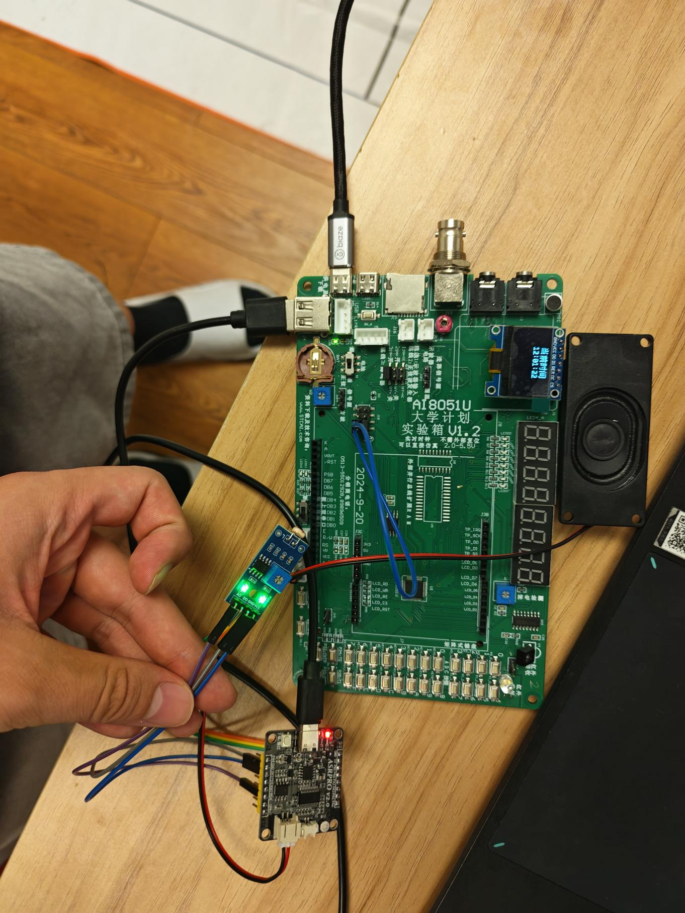
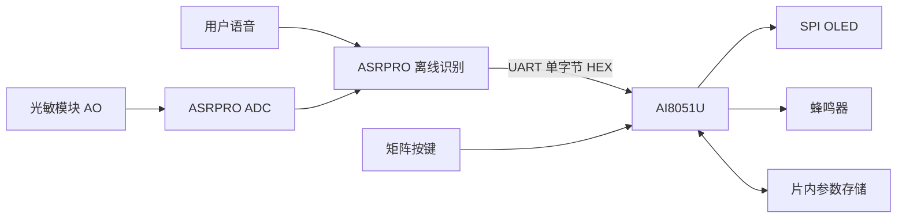

# AI8051U + ASRPRO 智能语音闹钟

基于 AI8051U 主控和 ASRPRO 离线语音模块的课程项目，支持矩阵按键设置、固定语音命令、OLED 显示、蜂鸣器提示与闹钟参数掉电保存。

按最终 `all` 工程整理，源码保持原样。项目为教学实验作品，已知限制见 [验证与改进清单](docs/READINESS.md)。



实物照片提取自本地期末报告，展示 AI8051U 实验板、OLED、ASRPRO、光敏模块与扬声器。

## 功能

- 24 小时软件计时，开机从 12:00:00 开始。
- 时间、参数、设置、响铃四种界面。
- S0-S7 矩阵按键，消抖、长按与连调。
- 语音设置、增减、切换字段、保存和停止响铃。
- 片内 EEPROM 保存闹钟时分秒与使能状态。
- “天亮叫我”后等待 PC4 ADC 原始值小于 1862，再通过 UART 触发响铃。

## 目录

```text
firmware/ai8051u/        主控 C/H 和 Keil 工程
firmware/asrpro/         ASRPRO _alarm.hd
docs/HARDWARE.md         元件与接线
docs/BUILD.md            编译与烧录
docs/DESIGN.md           模块设计、流程、EEPROM
docs/PROTOCOL.md         操作与协议
docs/READINESS.md        已知限制与测试清单
docs/PROVENANCE.md       来源与授权状态
docs/TESTING.md          已有调试及编译记录摘要
docs/images/            报告中的实物照片
docs/SOURCE_MANIFEST.csv 原始文件 SHA-256 清单
```

## 开始使用

1. 安装 Keil **C251**、STC AI8051U 设备支持及 ASRPRO 开发环境。
2. 按 [接线说明](docs/HARDWARE.md)确认硬件和电平。
3. 打开 `firmware/ai8051u/project.uvproj`，重新构建后烧录。
4. 在天问 Block 导入 `firmware/asrpro/_alarm.hd`，选择 ASRPRO 板型后编译下载；本机 SDK 的 PIN 20 对应 PC4。
5. 按 [操作说明](docs/PROTOCOL.md)进行整机测试。



## 发布状态

本次发布未重新编译或进行整机复测；已有记录见 [调试与测试说明](docs/TESTING.md)。作者保留个性化欢迎语，本仓库不提供操作视频。未附开源许可证，第三方例程、字模与位图的授权范围尚待核实；公开可见不等于授予再分发或改作许可。原始课程报告及厂家资料不随仓库发布。
