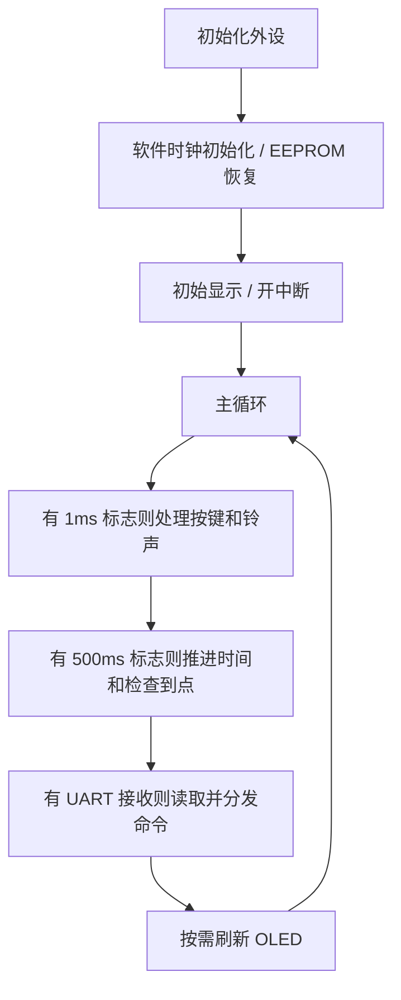

# 程序结构

| 前缀 | 职责 |
| --- | --- |
| a01 | 时钟常量、类型、芯片头文件 |
| a02 | Timer0 调度节拍、Timer1 发声频率 |
| a03 | UART2 |
| a04 | 按键扫描、消抖和事件 |
| a05 | 蜂鸣器音符 |
| a06 | SPI OLED 驱动 |
| a07 | 字模和响铃位图 |
| a08 | 软件时钟 |
| a09 | 闹钟、界面和命令业务 |
| a10 | 初始化与主循环 |
| a12 | EEPROM 底层和记录校验 |

头文件暴露接口，C 文件封装状态；底层驱动负责硬件，业务层负责操作规则。ASRPRO `.hd` 在另一处理器执行，不参与 Keil 编译。

## EEPROM

使用片内 IAP 区域，无需外接芯片。从 `0x40` 保存 7 字节：`A5 5A 时 分 秒 使能 校验`，校验为前六字节异或再异或 `0x3C`。

保存时检查参数，擦除所在扇区，逐字节写入及读回比较，再由业务层重新加载比较。IAP 触发序列 `0x5A`、`0xA5`，触发期间暂时关闭中断并恢复原状态。

启动检查标识、校验和范围，有效才恢复。无有效记录时闹钟默认 10:00:00、未使能。保存只在退出设置时执行，减少写入。当前时间不保存，每次从 12:00:00 开始。

E0 成功，E1 参数错误，E2 写后字节不一致，E3 重读字段不一致，E4 重读记录无效。当前源码没有 E5。单扇区方案无双备份、无磨损均衡，写入中途掉电可能丢失旧记录；所在扇区不要混存其他数据。

## 按键与误差

原始按键变化后等待 20 次名义 1ms 调度，稳定后更新状态；保持计数产生长按、连调，短按在释放时上报。

40 MHz / 1000 = 40000，可整除，Timer0 重装值 `0x63C0`。UART2 目标 115200 的除数约 86.806，取 87 后实际约 114942.53，误差约 -0.2235%。波特率取整误差不能等同于 1ms 定时误差。

IRC 精度、中断重装延迟、主循环处理不及时仍会影响计时。`f1ms`、`f500ms` 是位标志而非排队计数，阻塞时可能合并多个节拍。铃声为 Do/Re/Mi 各约 200 ms，静音约 1000 ms 后循环。

## 光敏检测

当前 XML 为 `UNTIL (ADC(PIN=20) < 1862)`，满足条件才发送 `0x16`。这是识别回调中的等待结构，不是独立的后台非阻塞任务；原注释 non-blocking 与结构不符。

假设 ADC 为 12 位、满量程 3.3V，`V = raw * 3.3 / 4095`。1862 约等于 1.5005V，1.0V 对应 1240.91。若严格小于 1V，可比较 `<=1240` 或 `<1241`，前提是确认 SDK 数值范围和参考电压。原始工程此次没有改门限。
