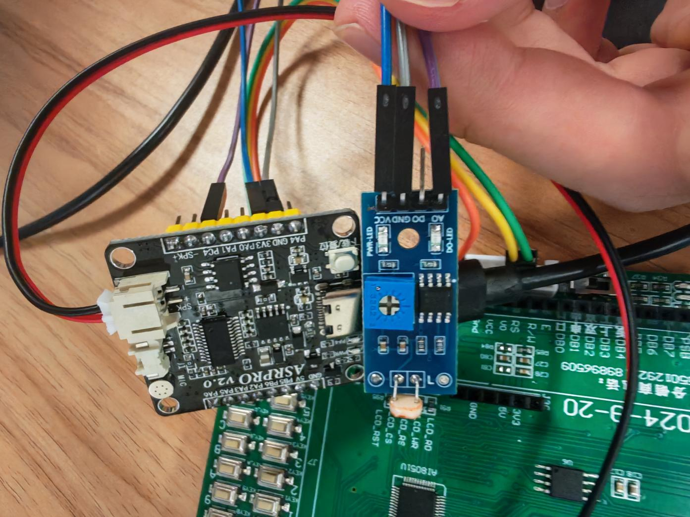

# 元件与接线

## 元件清单

| 部件 | 数量 | 备注 |
| --- | --- | --- |
| AI8051U 实验板 | 1 | 报告实物丝印为 AI8051U 大学计划实验箱 V1.2 |
| ASRPRO v2.0 | 1 | 麦克风、配套扬声器 |
| 128x64 七针 SPI OLED | 1 | 控制器、额定供电待确认 |
| 2 行 4 列矩阵按键 | 1 组 | S0-S7，实验板已有 |
| 蜂鸣器及驱动 | 1 组 | 实验板 P5.0 输出 |
| 光敏模块 | 1 | AO/DO/GND/VCC |
| 电源、下载线、杜邦线 | 若干 | 按板卡准备 |

## UART

| ASRPRO | AI8051U | 作用 |
| --- | --- | --- |
| PB5 / TX | P4.2 / UART2 RX | 命令发送 |
| PB6 / RX | P4.3 / UART2 TX | 预留反向通信 |
| GND | GND | 共地 |

串口波特率 115200，按常规 8N1 配置核实。ASRPRO 板按 5V 电源输入供电，电源电压不等于 GPIO 电平。主控 TX 接 ASRPRO RX 前确认板卡供电及电平兼容性。

## OLED

| OLED | AI8051U |
| --- | --- |
| SCK / D0 | P3.2 |
| SDA / MOSI / D1 | P3.3 |
| RES | P4.7 |
| DC | P1.1 |
| CS | P3.5 |
| GND | GND |
| VCC | 按实际模块额定供电 |

此处 SDA 是 SPI 数据输入，不是四针 I2C 接口。

## 按键与蜂鸣器

| 行线 | P0.0 | P0.1 | P0.2 | P0.3 |
| --- | --- | --- | --- | --- |
| P0.6 | S0 | S1 | S2 | S3 |
| P0.7 | S4 | S5 | S6 | S7 |

蜂鸣器通过 P5.0 和实验板原有驱动电路连接，不建议绕过驱动直接接负载。

## 光敏模块

| 光敏模块 | ASRPRO |
| --- | --- |
| VCC | 3V3 |
| GND | GND |
| AO | PC4（SDK 编号 20，AIN2） |
| DO | 不接 |

当前 `.hd` 的 ADC 引脚枚举 **20 已确认对应 PC4**。本机天问 Block SDK 中，`projects/offline_asr_sample/src/wiring.h` 的 `gpio_p_pin` 枚举定义 `PC_4=20`；`wiring.c` 中 `pinToFun[20]=29`；`driver/asrpro_chip_driver/inc/asrpro_scu.h` 定义 `PC4=29`，对应 AIN2。`adc_read(x)` 映射到 `analogRead(x)`，经这张表选择 ADC 通道。因此软件编号 20、芯片引脚编号 29 与 ADC 通道 2 是不同编号体系。

整机照片见 README，以上图片均来自期末报告。尚未提供包含供电与电平处理的完整系统电气原理图；实物照片和接线表不替代完整原理图。
